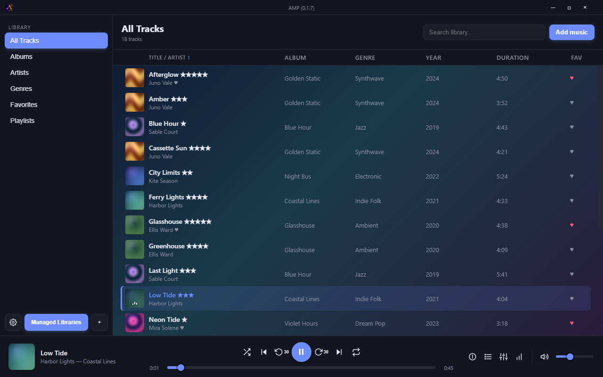
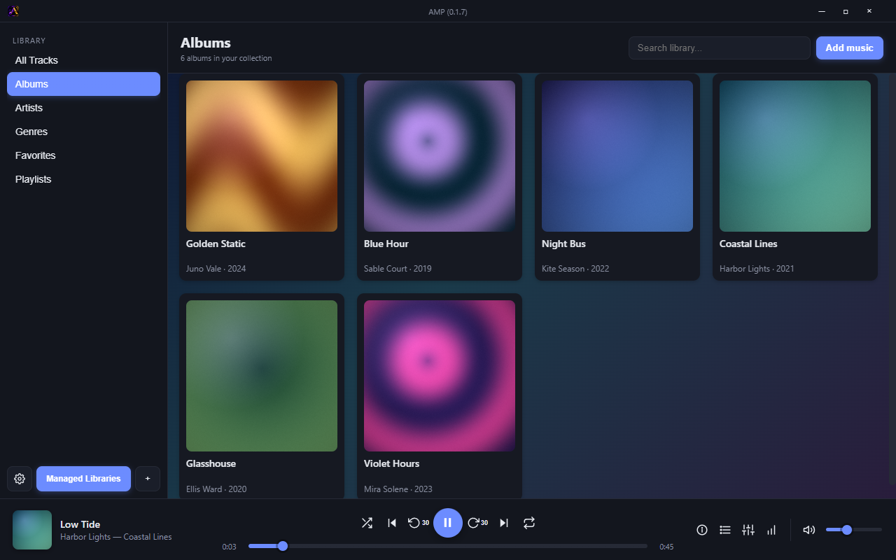

# Aurora Music Player

A desktop music player for Windows and Linux, made for people who keep their music in folders.

Aurora reads your local library, plays it, and remembers what you listen to. No account, no
telemetry, nothing uploaded anywhere. It started as a personal project and is still one.





## Download 0.1.9

- **[Windows installer](https://github.com/Shouls12/Aurora-Music-Player-Downloads/releases/download/v0.1.9/Aurora.Music.Player.Setup.0.1.9.exe)** — installs the app and registers common audio file types
- **[Windows portable](https://github.com/Shouls12/Aurora-Music-Player-Downloads/releases/download/v0.1.9/Aurora.Music.Player.0.1.9.exe)** — a single executable, no install
- **[Linux AppImage](https://github.com/Shouls12/Aurora-Music-Player-Downloads/releases/download/v0.1.9/Aurora.Music.Player-0.1.9.AppImage)** — `chmod +x` it, then run
- [SHA-256 checksums](https://github.com/Shouls12/Aurora-Music-Player-Downloads/releases/download/v0.1.9/SHA256SUMS.txt) · [release manifest](https://github.com/Shouls12/Aurora-Music-Player-Downloads/releases/download/v0.1.9/release-manifest.json) · [release notes](https://github.com/Shouls12/Aurora-Music-Player-Downloads/releases/tag/v0.1.9)

Not sure which Windows file to grab? The installer is the normal choice. The portable build is handy
for a USB stick or a machine where you can't install software.

## What's coming

Listening beyond your own files is next: podcast subscriptions with resume-where-you-left-off,
radio stations, scrobbling, and importing a Spotify library's names and playlists so you can match
them to music you own. The [roadmap](ROADMAP.md) has the plain-language plan.

## What's in it

- A Home screen of recent plays, picks and mixes, plus All Tracks, Albums, Artists, Genres and Favorites
- Automatic Top Artists and Top Genres lists, built from what you play
- Your own playlists with drag-to-reorder, M3U import/export, and smart playlists with rules
- A 10-band equalizer, 19 visualizers, crossfade, gapless playback, ReplayGain and a sleep timer
- Cue-sheet albums that split into individual tracks
- Synced lyrics that scroll with the song
- Tag editing straight to MP3, FLAC, Ogg Vorbis, Opus, WAV and AIFF files, including cover art
- Watch folders, a duplicate finder, and backup/restore for your library and settings
- Automatic updates for the installed build, with restart-or-later, plus more audio formats imported
  with their titles, artists and cover art
- Dark and light themes, a compact mini player, and global media keys

0.1.9 adds a Home screen, automatic listening playlists, batch track info, cue-sheet albums,
decoder-backed playback and tag editing for more formats. The [changelog](CHANGELOG.md) has the
details, and older builds live under
[releases](https://github.com/Shouls12/Aurora-Music-Player-Downloads/releases).

## A couple of honest notes

The Windows builds are unsigned. That's a deliberate choice for a free hobby project, so SmartScreen
will probably say "unknown publisher" the first time you run it. The AppImage is built and tested in
an isolated Linux environment.

Some formats need help to play. WMA, APE, WavPack and DSD files play when `ffmpeg` is on your PATH;
without it they stay in the library and the track list says what is missing. AIFF and ALAC files
import with their tags but do not play, and ALAC shares the `.m4a` container with AAC, so it reports
the unsupported format when you press play. MP3, FLAC, Ogg, Opus, WAV and AAC/M4A play directly.

## Checking your download

If you'd like to confirm the file arrived intact, compare it against `SHA256SUMS.txt`:

```bash
sha256sum -c SHA256SUMS.txt
```

On Windows PowerShell:

```powershell
Get-FileHash .\Aurora.Music.Player.Setup.0.1.8.exe -Algorithm SHA256
```

---

Aurora is a free hobby project. This repository only holds release builds; the source stays private.
The [roadmap](ROADMAP.md) and [changelog](CHANGELOG.md) are public. Built with Electron.
