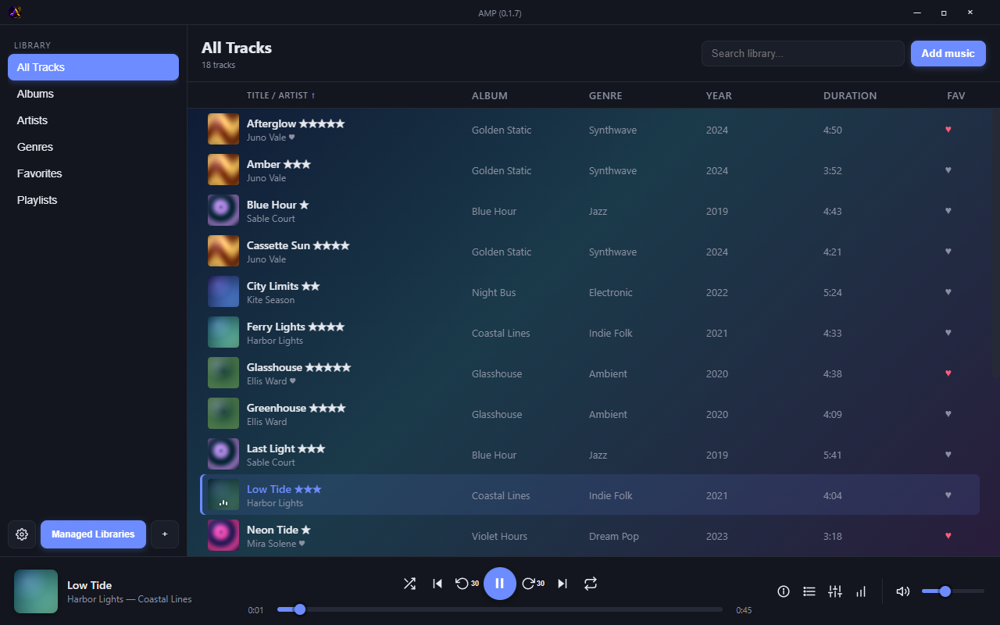
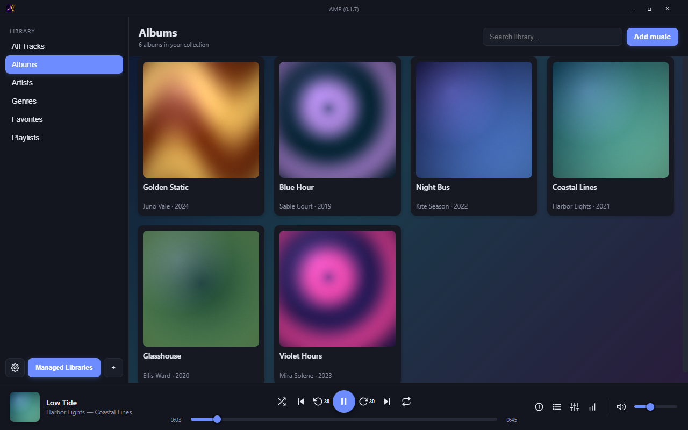

# Aurora Music Player

A desktop music player for Windows and Linux, made for people who keep their music in folders.

Aurora reads your local library, plays it, and remembers what you listen to. No account, no
telemetry, nothing uploaded anywhere. It started as a personal project and is still one.





## Download 0.1.7

- **[Windows installer](https://github.com/Shouls12/Aurora-Music-Player-Downloads/releases/download/v0.1.7/Aurora.Music.Player.Setup.0.1.7.exe)** — installs the app and registers common audio file types
- **[Windows portable](https://github.com/Shouls12/Aurora-Music-Player-Downloads/releases/download/v0.1.7/Aurora.Music.Player.0.1.7.exe)** — a single executable, no install
- **[Linux AppImage](https://github.com/Shouls12/Aurora-Music-Player-Downloads/releases/download/v0.1.7/Aurora.Music.Player-0.1.7.AppImage)** — `chmod +x` it, then run
- [SHA-256 checksums](https://github.com/Shouls12/Aurora-Music-Player-Downloads/releases/download/v0.1.7/SHA256SUMS.txt) · [release manifest](https://github.com/Shouls12/Aurora-Music-Player-Downloads/releases/download/v0.1.7/release-manifest.json) · [release notes](https://github.com/Shouls12/Aurora-Music-Player-Downloads/releases/tag/v0.1.7)

Not sure which Windows file to grab? The installer is the normal choice. The portable build is handy
for a USB stick or a machine where you can't install software.

## What's in it

- All Tracks, Albums, Artists, Genres and Favorites, plus automatic Recently Played and Most Played lists
- Your own playlists with drag-to-reorder, M3U import/export, and smart playlists with rules
- A 10-band equalizer, 18 visualizers, crossfade, gapless playback, ReplayGain and a sleep timer
- Synced lyrics that scroll with the song
- Tag editing straight to MP3, FLAC and Ogg Vorbis files, including cover art
- Watch folders, a duplicate finder, and backup/restore for your library and settings
- Dark and light themes, a compact mini player, and global media keys

0.1.7 added tag writing, smart playlists and a quieter title bar. The
[changelog](CHANGELOG.md) has the details, and older builds live under
[releases](https://github.com/Shouls12/Aurora-Music-Player-Downloads/releases).

## A couple of honest notes

The Windows builds are unsigned. That's a deliberate choice for a free hobby project, so SmartScreen
will probably say "unknown publisher" the first time you run it. The AppImage is built and tested in
an isolated Linux environment.

## Checking your download

If you'd like to confirm the file arrived intact, compare it against `SHA256SUMS.txt`:

```bash
sha256sum -c SHA256SUMS.txt
```

On Windows PowerShell:

```powershell
Get-FileHash .\Aurora.Music.Player.Setup.0.1.7.exe -Algorithm SHA256
```

---

This repository only holds release builds. Source, issue notes and the roadmap stay in the private
repository. Built with Electron.
